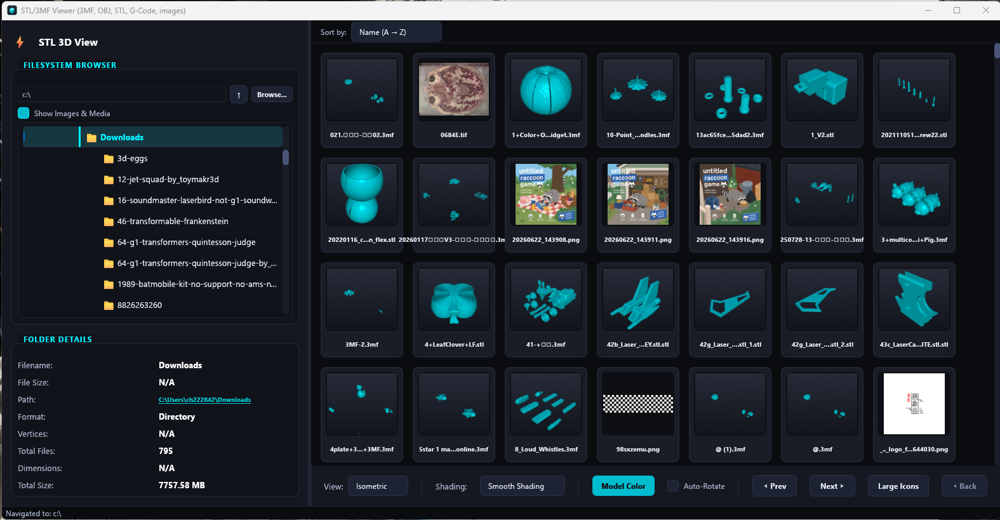
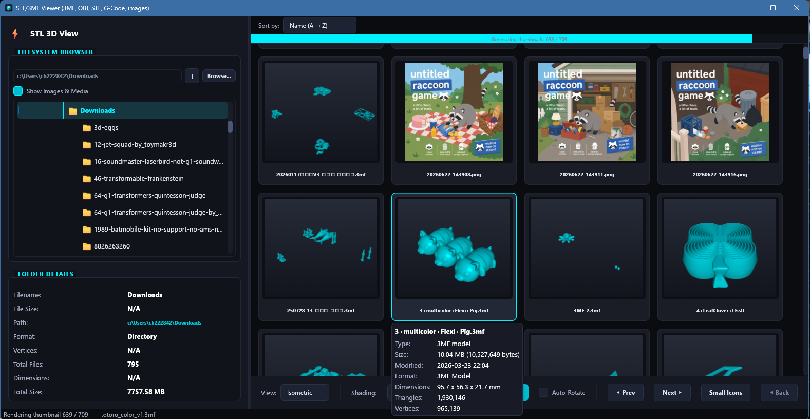
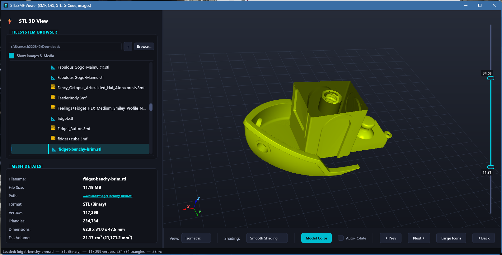
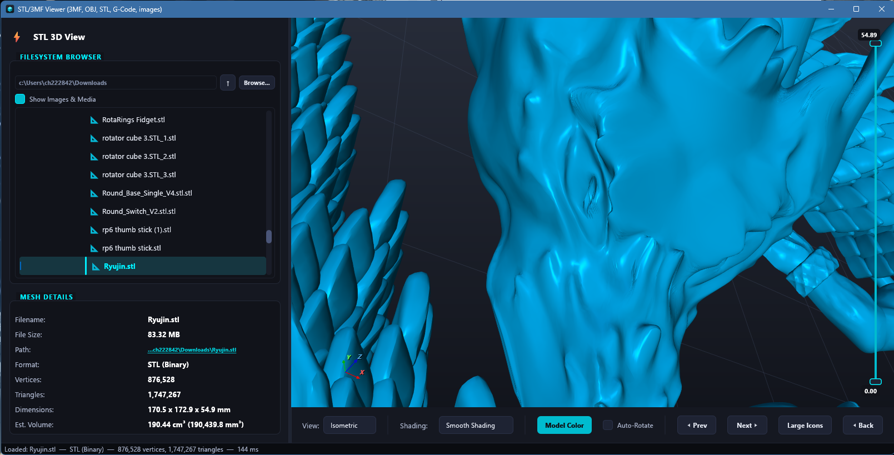

# STL Viewer

**A small, fast preview tool for 3D printing files.** Browse a folder and see every model and
image in it as a thumbnail, open a model to spin it around, check its size, triangle count and
volume, and slice through it before you send it to the slicer.

**[⬇ Download STLViewer.exe](https://github.com/willyci/stl-viewer/releases/latest/download/STLViewer.exe)** (Windows 10/11, 64-bit; no install needed), or see
[all releases](https://github.com/willyci/stl-viewer/releases).

- **3D models**: STL (ASCII and binary), 3MF (multi-part and multi-color), OBJ and G-code.
- **Images and media**: JPEG, PNG, BMP, TIFF, GIF, SVG and WebM video, in the same browser.
- **Portable, no install**: one `STLViewer.exe` with no runtime, DLLs or installer. Copy it
  anywhere, including a USB stick, and run it.
- **Thumbnail cache**: previews are rendered once and stored in a small SQLite database, so a
  folder you have seen before opens instantly.
- **Remembers your settings**: model color, last folder, icon size, sort order, window size
  and layout come back the next time you start it.
- **Written in Rust for speed**: models load on worker threads, thumbnails render on the GPU in
  the background, and meshes with millions of triangles stay smooth to orbit.

## Screenshots

**Folder grid**: every model and image in a folder as a thumbnail, sortable by name, size or
date.



**Large icons and file details**: double the thumbnail size, and hover a card for its type,
size, date, dimensions and triangle count. Thumbnails keep rendering in the background.



**3D view**: orbit, pan and zoom a model, change its color, and read its dimensions and volume.
The slider on the right cuts the model from the top or the bottom to look inside.



**Large meshes**: an 83 MB, 1.7-million-triangle STL loads in a fraction of a second.



## Quick start

1. [Download `STLViewer.exe`](https://github.com/willyci/stl-viewer/releases/latest/download/STLViewer.exe) and copy it to any folder.
2. Optional: put an empty file named `portable.txt` next to it to keep the cache and settings
   in a `cache` folder beside the exe (see [Settings and portable mode](#settings-and-portable-mode)).
3. Run it, or drag a folder or file onto it, or from a terminal: `STLViewer C:\path\to\models`.

Pick a folder in the file browser to see its thumbnails, then click a thumbnail (or a file in
the tree) to open it. Tick **Show Images & Media** to include pictures and videos.

## About this version

This is a Rust rewrite of the original PySide6 + VTK app in the parent folder: the same window,
file browser, thumbnail grid, 3D viewport and media viewers, built on [egui]/[eframe] with a custom
[wgpu] renderer. It shares the original's thumbnail cache, and adds the features listed under
[Differences from the Python app](#differences-from-the-python-app).

[egui]: https://github.com/emilk/egui
[eframe]: https://github.com/emilk/egui/tree/master/crates/eframe
[wgpu]: https://wgpu.rs

## Building

Requirements: Windows 10/11 and Rust 1.95+.

Every dependency is pure Rust, so no C compiler is needed. With the **MSVC** toolchain (Visual
Studio C++ build tools installed) plain `cargo` works. With the **windows-gnu** toolchain, run
cargo through the wrapper scripts:

```powershell
rustup component add llvm-tools     # once
.\build.ps1 build --release          # -> target\release\STLViewer.exe
.\build.ps1 run -- C:\path\to\models
.\build.ps1 test --workspace
```

From Git Bash: `source env.sh` once per shell, then use `cargo` normally.

Why the wrappers exist: the `windows` and `wgpu` crates link system DLLs via `raw-dylib`, which on
windows-gnu needs a `dlltool`. Rust's bundled one requires an assembler that isn't shipped, so the
scripts put LLVM's `llvm-ar` (which acts as an assembler-free dlltool under that name) on PATH from
`.tools/`, together with rust-lld's `ld.lld` shim. `.cargo/config.toml` then links with lld,
because GNU ld mis-links those import libraries (the exe crashes before `main`).

`default-members` is the app crate, so pass `--workspace` to test or lint everything.

## Running

```
STLViewer [PATH] [--cache-db FILE]
```

`PATH` is a folder to browse or a file to open (its folder becomes the tree root); without it the
tree starts at `C:\` like the original. `STLViewer --help` lists the debug options (`--select`,
`--shading`, `--preset`, `--screenshot`, `--script`, …) used for automated verification.

The GPU defaults to the power-saving adapter, as Windows does for the original app; set
`WGPU_POWER_PREF=high` to use a discrete GPU.

### Controls

| Action | Input |
|---|---|
| Orbit / pan / zoom | left drag / middle drag (or Shift+left) / wheel or right drag |
| Roll | Ctrl+left drag |
| Camera presets | "View:" dropdown (Isometric, Top, Front, Right, Back, Left, Bottom); pick again to reset |
| Step through files | tree arrow keys, or ◀ Prev / Next ▶ |
| Bigger folder previews | Large Icons / Small Icons (doubles the thumbnail size) |
| Return to the folder grid | ◀ Back, after opening a file from its thumbnail |
| Sort the folder grid | "Sort by" dropdown: name, size or date, each in both directions |
| File details | hover a thumbnail: type, size, date, dimensions, counts, and why a preview is missing |
| Cross-section | drag the Z slider handles at the right of the 3D view to cut from the top or bottom; double-click it to reset |
| Image zoom / pan | wheel (anchored at the cursor) / left drag |
| Copy a file's path | click the Path value in the details panel |

## Thumbnail cache

Thumbnails live in the same SQLite database as the Python app's —
`%USERPROFILE%\.gemini\antigravity-ide\thumbnails.db`, or `<exe dir>\cache\thumbnails.db` when a
`portable.txt` file sits next to the executable — with the same schema and keys
(`MD5(absolute path)`, validated by mtime and size), so both apps can share it. SQLite comes from
Windows' own `winsqlite3.dll`.

## Settings and portable mode

The app remembers the model color, the browser's root and the last folder shown (reopened
at startup when no `PATH` is given), "Show Images & Media", Large Icons, the sort order,
the window size and the sidebar width. They are saved to `settings.json` next to the
thumbnail cache, so with `portable.txt` beside the exe both live in `<exe dir>\cache\`
and the whole app can run from a USB stick.

## Workspace layout

| Crate | Role |
|---|---|
| `stlv-core` | `ModelData`, the STL/3MF/OBJ/G-code parsers, vertex dedup and VTK-equivalent split normals (`vtkPolyDataNormals`), file kinds, formatting, palette. No GUI dependencies. |
| `stlv-render` | wgpu renderer reproducing the VTK look (lights, material, gradient, grid, 8× MSAA): the interactive `Viewport3D` egui widget and a thread-safe off-screen `ThumbnailRenderer`. |
| `stlv-thumbs` | The thumbnail cache and `ThumbnailService`, which parses, renders and decodes thumbnails on background threads for the folder grid and the pre-cache. |
| `stlv-media` | `ImageViewer` (tiled mipmapped rasters, streamed GIFs, re-rasterized SVG) and `VideoPlayer` (WebM through Media Foundation's `IMFMediaEngine`). |
| `stl-viewer` | The app (`STLViewer.exe`): layout, theme, file tree, details panel, grid, dialogs, flows. |

Threading: parsing and mesh preparation run on worker threads and stale results are discarded by
generation number; the UI thread only uploads GPU buffers. Thumbnails render on one dedicated GPU
thread fed by a bounded parser pool. Video decoding runs on its own COM/Media Foundation thread.

Each library crate has examples used during development, e.g.
`cargo run -p stlv-render --example view_model -- model.stl`,
`cargo run -p stlv-core --example dump_model -- model.3mf` (JSON summary of a parse).

## Differences from the Python app

Deliberate fixes and changes; everything else aims to match the original.

- **3MF transforms** are applied as row vectors, as the 3MF specification defines. The Python
  code applied the transpose, so rotated build items and components came out rotated the wrong way
  (in `models/@.3mf` some parts sank below the plate).
- **3MF units** are converted to millimetres (`unit="inch"` etc.), and the root model part is
  located through `_rels/.rels` before falling back to `3D/3dmodel.model`.
- **Malformed input never crashes or hangs**: OBJ faces and 3MF triangles with out-of-range indices
  are dropped, unparsable 3MF numbers read as 0, a trailing partial ASCII STL triangle is ignored,
  and hostile files (zip bombs, deep nesting, component cycles) are rejected or bounded.
- A binary STL whose header happens to start with `solid … facet` is recognised by its exact size.
- G-code accepts `G00`/`G01` as well as `G0`/`G1`.
- **Prev / Next** step through the files visible in the tree (the original also visited hidden
  media and could get stuck on them).
- Image zoom is anchored at the mouse cursor; SVGs are re-rendered so they stay sharp at any zoom.
- The ground grid is centred under the model (the original centred it on the world origin, so
  models placed away from 0,0 sat off the grid).
- The video button returns to "Play" at the end of the media.
- Thumbnails render on a background GPU thread instead of the UI thread, several times faster.
- The folder grid renders previews for meshes up to 100 MB (the original skipped anything over
  10 MB); files over 10 MB render after the smaller ones so they never hold up the folder.
- Opening a model saves its thumbnail to the cache if it has none, so files the grid skips
  (over 100 MB) get a preview once they have been opened.
- The Error and Color dialogs are in-app dark dialogs rather than native Qt dialogs.
